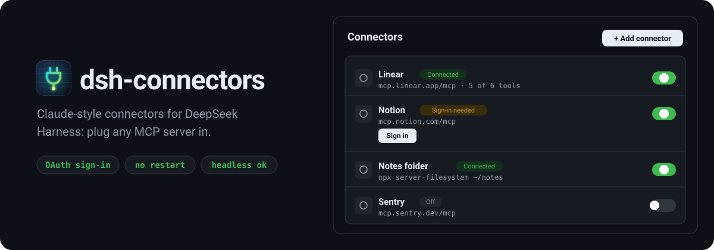
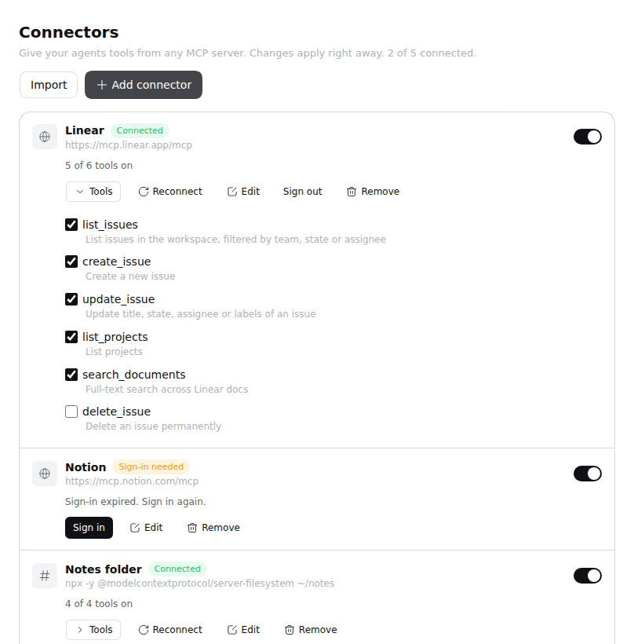
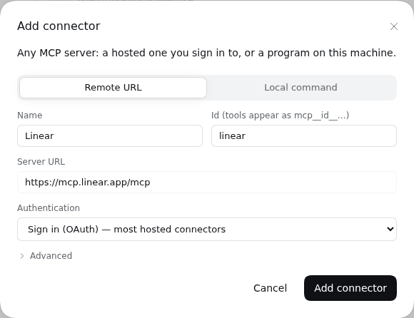

<p align="center">
  
</p>

<p align="center">
  <a href="https://www.npmjs.com/package/dsh-connectors"></a>
  <a href="https://www.npmjs.com/package/dsh-connectors"></a>
  
  <a href="LICENSE"></a>
  <a href="https://github.com/awesome-dsh-plugin/awesome-dsh-plugin"></a>
</p>

A [DeepSeek Harness](https://github.com/deepseek-ai/deepseek-harness) (dsh) plugin that brings **Claude-style connectors** to your agents: add any MCP server from a page in the sidebar, sign in once, and its tools show up in every chat. Hosted servers with an OAuth login, servers that want a token, and local programs all work the same way. No YAML, no restart per server.

```bash
npx @deepseek-ai/dsh plugin --profile web add dsh-connectors
```

Reload the browser tab. **Connectors** appears in the sidebar, right below Projects. Full details under [Install](#install).

<p align="center">
  
</p>

<p align="center">
  
  <br><sub>Add a connector: paste the URL, pick how it signs in. A new OAuth connector opens its sign-in page right away.</sub>
</p>

## What it does

- **Any MCP server.** Remote (Streamable HTTP, with automatic fallback to the older SSE transport) or a local command over stdio (`npx`, `uvx`, `docker`, anything).
- **Real sign-in.** OAuth 2.1 with PKCE, server discovery (RFC 9728 / RFC 8414) and dynamic client registration, done by the official MCP SDK. Works with hosted connectors like Linear, Notion, Sentry or your own FastMCP server behind GitHub login.
- **Works when dsh runs on a server.** Signing in from your laptop to a headless dsh box is the usual case, not an afterthought. See [Signing in](#signing-in).
- **Stays signed in.** Tokens live in dsh's own credential store, survive restarts and refresh on their own.
- **Heals itself.** Dropped connections reconnect with backoff. A tool call during a hiccup waits a few seconds for the server instead of failing.
- **You decide what agents see.** Turn a whole connector off, or switch single tools off (say, `delete_issue`).
- **Import.** Paste an `mcpServers` block from Claude Desktop, Cursor, VS Code or a server's README. Tokens in an `Authorization` header move to the credential store.
- **Fits in.** Built from dsh's own buttons, switches, tags and dialogs, so it follows your theme in light and dark mode.

Tools appear as `mcp__<id>__<tool>`, the same names dsh's built-in MCP client uses.

## Where it shows up

- **Sidebar → Connectors**, just below Projects. It is a normal dsh panel, so the shell's **More** menu can hide or show it.
- **Settings → Connectors**: the same page, for people who look there first.

Nothing in dsh is patched. Both entries are registered by the plugin through dsh's slot system.

## Signing in

1. Click **Sign in** on a connector. The provider's login page opens in a new tab.
2. **dsh on the same computer as your browser:** that's it. The page updates by itself.
3. **dsh on a server** (you open it as `https://dsh.example.com`): after you log in, the tab ends on a page that can't load, at `http://127.0.0.1:47391/callback?code=…`. That's expected. Copy that address, paste it into the box on the Connectors page, and click **Finish**.

Why the paste step: OAuth sends your browser back to a fixed address on the dsh machine. dsh's own web routes can't take that redirect, because dsh deliberately refuses cross-site requests and uses a strict session cookie. A loopback address plus "paste the URL" is the same pattern `gcloud`, `rclone` and other CLI tools use on remote machines.

## Install

Into your dsh **web profile** (`web` below is the profile name; use the one that backs your web GUI). From a source checkout, use `pnpm dsh` instead of `npx @deepseek-ai/dsh`:

```bash
npx @deepseek-ai/dsh plugin --profile web add dsh-connectors
```

This installs the package and adds it to `dsh.profile.bundles`. If **Connectors** doesn't show up after a browser reload, restart dsh once. After that, adding, editing and removing connectors never needs a restart.

Requires dsh `0.2.2-rc.1` or newer and Node 20+.

## Configuration

Everything is done on the Connectors page. Two optional settings for the plugin entry in `cordis.patch.yml`:

| Key | Default | What it does |
| --- | ------- | ------------ |
| `file` | `$DSH_HOME/connectors.json` | Where the connector list (no secrets) is saved |
| `callbackPort` | `47391` | Loopback port for the sign-in redirect. Keep it fixed: client registrations are tied to it |

## Security

- **Secrets never touch the connector list.** Tokens, client secrets and OAuth grants go to dsh's credential store (`dsh-connectors/<id>` records). The list file is written with mode `600` anyway.
- **Secrets never reach the browser.** The page only learns *whether* a token is saved.
- **The sign-in listener only runs while a sign-in waits**, binds to `127.0.0.1`, checks the OAuth `state` and stops afterwards. Unused sign-ins expire after 15 minutes.
- **The management route sits behind dsh's own login** and trust checks, like every other `/api` route.
- **Local commands run as your user**, like any MCP server you'd add by hand. Only add commands you trust.

## Building from source

```bash
git clone https://github.com/JoblessJoe/dsh-connectors.git
cd dsh-connectors
npm install
npm test        # builds lib/, then runs end-to-end tests against a real MCP server (stdio + HTTP)
```

`node scripts/build.mjs` alone emits `lib/index.js` (host) and `lib/client.js` (web).

## Credits

Ideas from two earlier dsh MCP plugins: the settings-page approach of [dsh-mcp-oauth-client](https://github.com/fangzaozao/dsh-mcp-oauth-client) and the credential-store and output-cap ideas of [dsh-mcp-oauth](https://github.com/k0ndrateff/dsh-plugins). Both MIT.

## License

MIT

> **中文简介** · DeepSeek Harness (dsh) 插件：像 Claude 一样的「连接器」。在侧边栏的 Connectors 页面添加任意 MCP 服务器（远程 OAuth 登录、令牌或本地命令），工具立即出现在所有对话中，无需 YAML、无需重启。支持 OAuth 2.1 + PKCE、令牌自动刷新、断线自动重连、按工具开关、从 Claude Desktop 配置导入；dsh 运行在服务器上时同样可以登录。<br>安装：`npx @deepseek-ai/dsh plugin --profile web add dsh-connectors`
